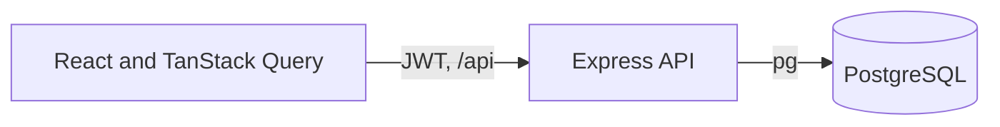
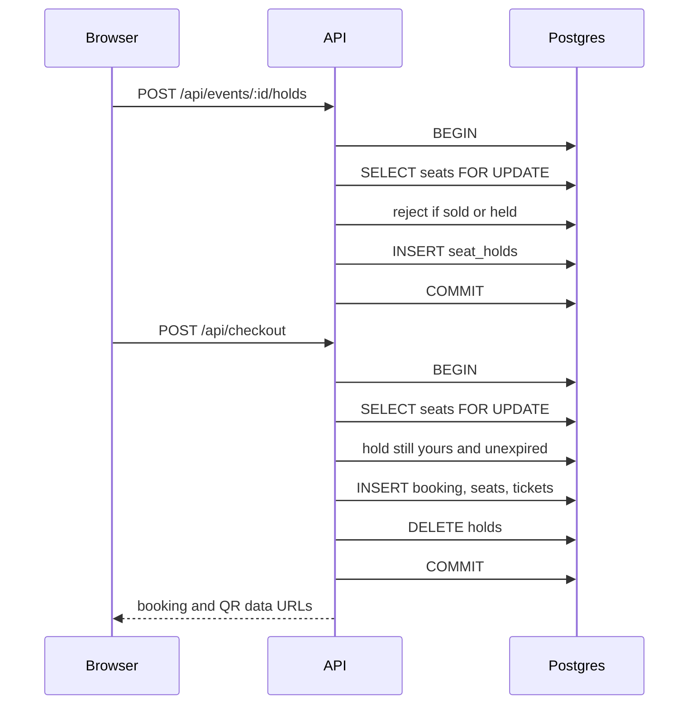

# TicketWave

TicketWave is a small site for selling seats to a show. You browse what's on sale, hold specific seats, and check out before the hold runs out. If you walk away, the seats go back on sale by themselves.

The API is Express on Node, talking to PostgreSQL through `pg`. The UI is React, and server data goes through TanStack Query. Sign-in is a JWT. A confirmed seat gets a QR code. Docker Compose runs Postgres, and can run the API and the web app too.

Selling one seat twice is the bug the booking path is built to avoid. Holds and checkout both lock the seat rows with `SELECT … FOR UPDATE` inside a transaction. `booking_seats.seat_id` is the primary key, so the database also refuses a second sale.

## Features

- Show list, seat map, checkout, and a ticket wallet.
- Register and sign in. Passwords are hashed with bcrypt. The API expects `Authorization: Bearer`.
- Hold up to six seats. A hold lasts two minutes by default (`HOLD_TTL_SECONDS`) and is ignored once `expires_at` has passed. A sweeper deletes the leftover rows.
- Checkout locks those seats again, checks that you still hold them, and writes the booking, the sold seats, and one ticket per seat in the same transaction.
- Each ticket has a QR code that points at a public verify URL. The PNG is also available to the account that bought it.
- Jest and Supertest cover auth, holds, expiry, QR tickets, and concurrent bookings against a real Postgres database.

There is no card processor. Confirming a checkout is what sells the seats.

## Architecture





Show times are stored as `timestamptz` and displayed in Pacific time, because the rooms in the sample data are in the Bay Area.

## Layout

```
client/                 React app (Vite)
  src/pages/            Shows, seat map, checkout, tickets, sign-in
  src/components/       Shell and seat map
  Dockerfile            Built app behind nginx, /api proxied to the API
server/
  src/schema.sql        Tables
  src/routes/           HTTP
  src/services/         Holds, checkout, tickets
  src/seed.js           Four sample shows, 80 seats each
  tests/                Jest and Supertest
  Dockerfile
docker-compose.yml      Postgres, API, and web
```

## Running it locally

You need Node 20 or newer, and Docker.

```bash
cp .env.example .env
docker compose up -d db
npm install --prefix server
npm install --prefix client
```

The API applies the schema on startup and seeds shows when the events table is empty. In one terminal:

```bash
npm run dev:api
```

In another:

```bash
npm run dev:web
```

Open http://localhost:5173. The Vite dev server proxies `/api` to port 4000.

`npm run migrate` and `npm run seed` do those steps on their own if you want them before starting the API. Set `SEED_ON_BOOT=false` when you do not want a restart to insert sample shows into an empty database.

To run the whole stack in containers (web on port 8080, API on port 4000):

```bash
docker compose up --build
```

The Compose database publishes port 5432, same as a local Postgres. Stop one before starting the other. Change `JWT_SECRET` in `.env` before you point Compose at anything but your own machine. Do not commit `.env`.

### A short tour

1. Create an account.
2. Open a show and select a few open seats. Hold them.
3. Checkout before the timer hits zero. Your tickets show a QR code.
4. The code encodes `{PUBLIC_URL}/api/tickets/verify/{code}`. Opening that URL returns the show, the seat, and the name on the ticket. It does not return the email.

## Tests

Start Postgres first (`docker compose up -d db`), then:

```bash
npm test
```

Tests talk to `ticketwave_test` on that server (override with `TEST_DATABASE_URL`). They create the database if it is missing, drop and recreate the `public` schema, and never use the `ticketwave` database you browse with.

The concurrency file fires eight hold requests at one seat and expects a single winner, then checks that a double checkout writes one booking. Another case lets a hold expire and races the old buyer against someone who took the seat afterward.

Lint and the client build:

```bash
npm run lint
npm run build
```

## Design notes

Holds and checkout lock seat rows in primary-key order. Two transactions that want overlapping seats then wait in the same order, instead of deadlocking. The isolation level stays `READ COMMITTED`. The row lock is what makes the read of "is this sold, is this held?" safe, because the other writer has to take the same lock first.

A hold is a row with `expires_at`. Queries treat a hold in the past as gone, and the hold request deletes expired rows for the seats it locked before it looks for a live hold. The sweeper is only there so old rows do not sit in the table. The client timer is a hint. Checkout checks the hold again under the lock.

`booking_seats.seat_id` is the primary key. If a check were wrong, the second insert would still fail, and the API turns that unique violation into a 409.

Prices are integer cents. The QR image is not stored. It is built from the ticket code when a booking is read, and the PNG route rebuilds it for the owner. Anyone with the code can hit the verify route, which is the point of putting that URL in the image. Ticket codes are 8 random bytes, hex encoded.

Auth is a signed JWT in the `Authorization` header, which is also what the tests send. The production image refuses to boot without `JWT_SECRET`. Locally, an unset secret falls back to a dev value so you can start without extra setup.
